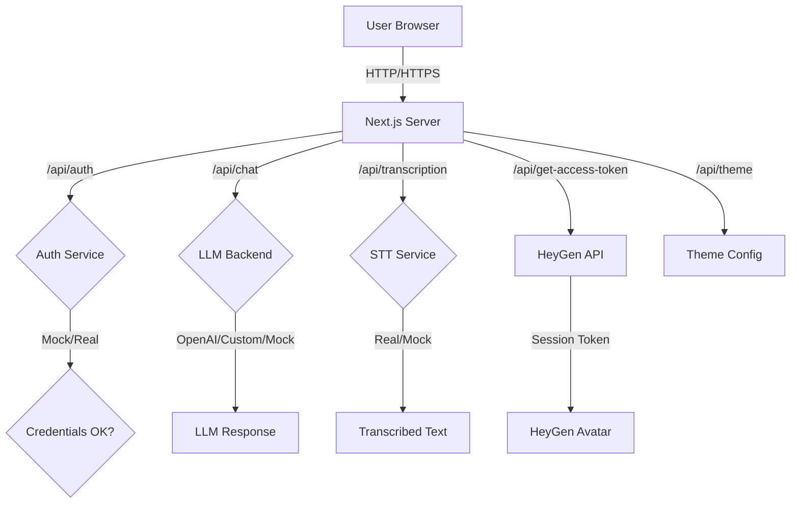

# Architecture Overview

**Use this document when you want to understand the overall structure and data flow of the avatar-dguv-nextjs application.**

## Overview

The avatar-dguv-nextjs application is a Next.js 16 (App Router) web chat frontend for the EMMA platform, branded for DGUV (German accident insurance). It provides a conversational interface with optional HeyGen Live Avatar video integration, speech-to-text transcription, and LLM-powered responses.



## Project Structure

```
avatar-dguv-nextjs/
├── app/
│   ├── layout.tsx              # Root layout: Header + Footer
│   ├── page.tsx                # Home page: redirects to /welcome
│   ├── (chatbot)/
│   │   └── layout.tsx          # Chatbot layout: BlueBox + FeedbackButton
│   ├── chat/
│   │   └── page.tsx            # Chat interface page
│   ├── welcome/
│   │   └── page.tsx            # Welcome landing page
│   └── api/
│       ├── auth/route.ts       # JWT authentication
│       ├── chat/route.ts       # LLM chat endpoint
│       ├── transcription/route.ts  # Speech-to-text proxy
│       ├── get-access-token/route.ts # HeyGen session token
│       ├── theme/route.ts      # Theme configuration
│       └── health/route.ts     # Health check
├── components/
│   ├── ChatContent.tsx         # Chat state & logic (client)
│   ├── chat/
│   │   ├── ChatLayout.tsx      # Chat UI container
│   │   ├── MessageList.tsx     # Message display
│   │   └── ChatInputArea.tsx   # Input & buttons
│   ├── BlueBox.tsx             # Chatbot wrapper container
│   ├── FeedbackButton.tsx      # Feedback UI
│   ├── Header.tsx              # App header
│   ├── Footer.tsx              # App footer
│   └── ...
├── public/
│   └── assets/
│       └── theme.json          # DGUV branding config
└── docs/
    ├── getting-started/
    ├── understanding-features/
    ├── deployment-operations/
    └── api-reference/
```

## Key Architectural Decisions

### Route Organization

- **Root layout** (`app/layout.tsx`) wraps the entire application with `Header` and `Footer`
- **Chatbot layout** (`app/(chatbot)/layout.tsx`) adds `BlueBox` and `FeedbackButton` to `/chat` and `/welcome` pages
- Root home page (`app/page.tsx`) automatically redirects to `/welcome`

### State Management

- **Chat state** lives entirely in `ChatContent.tsx` (client component marked with `"use client"`)
- State includes: messages list, input text, loading/recording flags, audio handling
- All API calls are made from the client to Next.js server routes, which then proxy to external services

### API Architecture

All API endpoints are server-side routes in `app/api/`, which either:
1. **Proxy to external services** (custom LLM, STT, HeyGen, external auth)
2. **Simulate responses** (mock/echo mode for local development)
3. **Generate tokens** (JWT auth, HeyGen session tokens)

This design isolates API credentials server-side and provides fallback behaviors.

### LLM Priority Chain

`POST /api/chat` uses this priority order:

1. **OpenAI** — if `OPENAI_API_KEY` is set, use OpenAI GPT-4o-mini
2. **Custom LLM** — if `LLM_URL` and `LLM_HEADER` are set, proxy to custom backend
3. **Mock/Echo** — return echo of user input (or wait 35s for `*waittesting*`)

### Authentication Modes

`POST /api/auth` supports:

1. **Simulation mode** — if `AUTH_URL` or `AUTH_HEADER` are empty, only accept `emmaId=1234` and `email=test@test.com`
2. **Real auth** — if both are set, proxy to external auth service and return its response

## Technology Stack

- **Framework**: Next.js 16 with App Router
- **Runtime**: React 19
- **Language**: TypeScript 5
- **Styling**: Tailwind CSS v4
- **Authentication**: jsonwebtoken (JWT)
- **LLM Client**: OpenAI SDK
- **Deployment**: Docker container or standalone Node.js

## DGUV Branding

The app uses DGUV branding configured in `public/assets/theme.json`:

- **Primary blue**: `#004994`
- **Light blue**: `#d4edfc`
- **Text color**: `#003366`
- **Font**: Source Sans 3

Theme values can be overridden at runtime via `THEME_*` environment variables.

## Related Topics

- [Chat Interface Feature Guide](../understanding-features/chat-interface.md)
- [HeyGen Avatar Integration Guide](../understanding-features/heygen-avatar-integration.md)
- [Environment Setup and Deployment](../deployment-operations/environment-setup.md)
- [API Reference: Endpoints](../api-reference/endpoints.md)
