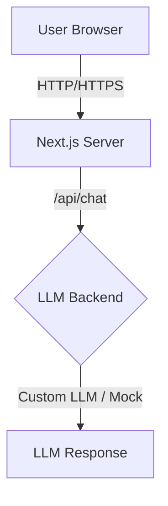

# Architecture Overview

**Use this document when you want to understand the overall structure and data flow of the avatar-dguv-nextjs application.**

## Overview

The avatar-dguv-nextjs application is a Next.js 16 (App Router) web chat frontend for the EMMA platform, branded for DGUV (German accident insurance). It provides a conversational interface with LLM-powered responses.



## Project Structure

```
avatar-dguv-nextjs/
├── app/
│   ├── layout.tsx              # Root layout: Header + Footer
│   ├── (chatbot)/
│   │   ├── layout.tsx          # Chatbot layout: BlueBox + FeedbackButton
│   │   ├── chat/page.tsx       # Chat interface page
│   │   └── welcome/page.tsx    # Welcome landing page
│   └── api/
│       └── chat/route.ts       # LLM chat endpoint
├── components/
│   ├── chat/                   # ChatContent, ChatLayout, MessageList, ChatInputArea, ...
│   ├── welcome/                # WelcomeContent, AvatarCircle, ContentCard
│   ├── BlueBox.tsx
│   ├── FeedbackButton.tsx
│   ├── Header.tsx
│   └── Footer.tsx
├── hooks/
│   ├── useAudioRecorder.ts
│   └── useChatMessages.ts
├── public/
│   └── *.svg                   # Icons und Logos
└── docs/
    ├── getting-started/
    ├── understanding-features/
    ├── deployment-operations/
    └── api-reference/
```

## Key Architectural Decisions

### Route Organization

- **Root layout** (`app/layout.tsx`) wraps the entire application with `Header` and `Footer`
- **Chatbot layout** (`app/(chatbot)/layout.tsx`) adds `BlueBox` and `FeedbackButton` to `/chat` and `/welcome` pages
- Root home page (`app/page.tsx`) automatically redirects to `/welcome`

### State Management

- **Chat state** lives entirely in `ChatContent.tsx` (client component marked with `"use client"`)
- State includes: messages list, input text, loading flags
- All API calls are made from the client to Next.js server routes, which then proxy to external services

### API Architecture

All API endpoints are server-side routes in `app/api/`, which either:
1. **Proxy to external services** (custom LLM, STT, HeyGen)
2. **Simulate responses** (mock/echo mode for local development)
3. **Generate tokens** (HeyGen session tokens)

This design isolates API credentials server-side and provides fallback behaviors.

### LLM Priority Chain

`POST /api/chat` uses this priority order:

1. **Custom LLM** — if `LLM_URL` and `LLM_HEADER` are set, proxy to custom backend
2. **Mock/Echo** — return echo of user input (or wait 35s for `*waittesting*`)

## Technology Stack

- **Framework**: Next.js 16 with App Router
- **Runtime**: React 19
- **Language**: TypeScript 5
- **Styling**: Tailwind CSS v4
- **Deployment**: Docker container or standalone Node.js

## Related Topics

- [Chat Interface Feature Guide](../understanding-features/chat-interface.md)
- [Environment Setup and Deployment](../deployment-operations/environment-setup.md)
- [API Reference: Endpoints](../api-reference/endpoints.md)
