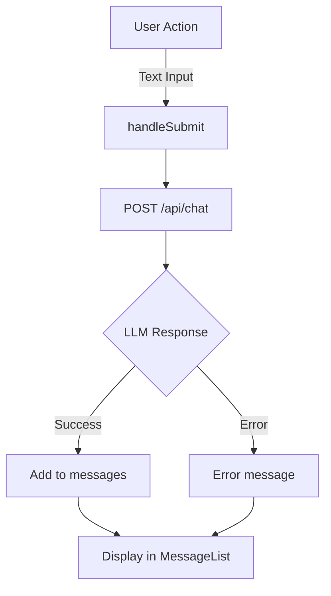

# Chat Interface Feature Guide

**Use this document when you want to understand how the chat system works end-to-end, including user input, message handling, and LLM responses.**

## Prerequisites

- Familiarity with React hooks (`useState`, `useRef`, `useEffect`)
- Understanding of JavaScript async/await and fetch API
- Knowledge of Next.js API routes

## Overview

The chat interface provides a conversational experience where users send text messages and receive responses from an LLM backend. The system supports text input, message history display, and loading states.



## How It Works

### Core Components

- **ChatContent.tsx** (`components/ChatContent.tsx`): Main state management component. Handles form submission and API calls.
- **ChatLayout.tsx** (`components/chat/ChatLayout.tsx`): Container component for chat UI (layout structure).
- **MessageList.tsx** (`components/chat/MessageList.tsx`): Displays all messages and loading indicator.
- **ChatInputArea.tsx** (`components/chat/ChatInputArea.tsx`): Text input field and send button.

### Process Flow

#### 1. Text Message Submission

```typescript
// User enters text and presses Enter or clicks Send
const handleSubmit = async (e: React.FormEvent) => {
  e.preventDefault();
  if (!input.trim() || isLoading) return;
  
  // Add user message to chat
  const userMessage: Message = { role: "user", content: input };
  setMessages((prev) => [...prev, userMessage]);
  setInput("");
  setIsLoading(true);
  
  try {
    // Call backend chat API
    const response = await fetch("/api/chat", {
      method: "POST",
      headers: { "Content-Type": "application/json" },
      body: JSON.stringify({
        msg: input,
        language: "de"
      }),
    });
    
    const data = await response.json();
    
    // Add assistant response to chat
    const assistantMessage: Message = {
      role: "assistant",
      content: data.response || "Entschuldigung, es gab einen Fehler.",
    };
    setMessages((prev) => [...prev, assistantMessage]);
  } catch (error) {
    // Handle error
  } finally {
    setIsLoading(false);
  }
};
```

**Key states managed:**
- `messages: Message[]` — All chat messages with role ("user" or "assistant") and content
- `input: string` — Current text in input field
- `isLoading: boolean` — True while waiting for LLM response

**Keyboard support:**
- Enter key submits the form
- Shift+Enter adds a newline (textarea behavior)

#### 2. Auto-Scroll to Latest Message

```typescript
// Scroll chat to bottom when new messages arrive
useEffect(() => {
  scrollToBottom();
}, [messages]);

const scrollToBottom = () => {
  messagesEndRef.current?.scrollIntoView({ behavior: "smooth" });
};
```

A hidden `<div ref={messagesEndRef} />` at the bottom of the message list ensures new messages are always visible.

### Key Files and Functions

| File | Function/Component | Purpose |
|------|-------------------|---------|
| `components/ChatContent.tsx` | `ChatContent()` | Main chat state, form handling, API calls |
| `components/ChatContent.tsx` | `handleSubmit()` | Sends text message to LLM |
| `components/chat/MessageList.tsx` | `MessageList()` | Renders message history and loading indicator |
| `components/chat/ChatInputArea.tsx` | `ChatInputArea()` | Text input field and Send button |
| `app/api/chat/route.ts` | `POST /api/chat` | Routes to custom LLM or mock |

## Configuration

### Environment Variables

- `LLM_URL` — Custom LLM backend endpoint (e.g., `http://localhost:8000/chat`)
- `LLM_HEADER` — JSON-stringified headers for custom LLM (e.g., `'{"Authorization": "Bearer token"}'`)

### Custom LLM Backend Contract

If using a custom LLM backend (not OpenAI), the service must accept and return this JSON format:

**Request to backend:**
```json
{
  "msg": "Wie viel kostet die Mitgliedschaft?",
  "language": "de",
  "context": "optional-session-id"
}
```

**Response from backend:**
```json
{
  "msg": "Wie viel kostet die Mitgliedschaft?",
  "response": "Die Mitgliedschaft kostet ...",
  "language": "de",
  "context": "optional-session-id"
}
```

The response's `response` field is displayed to the user.

## Simulation and Mock Modes

### Chat Mock Mode

If no LLM backend is configured, `POST /api/chat` returns an echo response:

```json
{
  "msg": "User message",
  "response": "Echo: User message",
  "language": "de",
  "context": null
}
```

**Special test trigger:** If the message contains `*waittesting*`, the response delays 35 seconds (for testing long waits).

## Error Handling

### Common Error Scenarios

- **Chat API error** → Assistant message "Fehler bei der Verbindung zum Server." (server connection error)
- **Invalid LLM response** → Falls back to "Entschuldigung, es gab einen Fehler." (sorry, there was an error)

### Troubleshooting

**Symptom:** Chat sends but no response appears

**Cause:** LLM service is down, API key is invalid, or timeout occurred

**Solution:**
1. Check network tab in browser DevTools for failed requests
2. Verify `LLM_URL` and `LLM_HEADER` are set correctly
3. Test the LLM endpoint directly with curl: `curl -X POST http://llm-url -d '{"msg":"test"}'`
4. Check server logs for error details

## Limitations and Considerations

- **No message persistence** — Messages are stored only in client memory; page refresh loses chat history
- **No retry logic** — If LLM request fails, user must send message again
- **Single LLM priority** — System picks one backend (custom LLM > mock); cannot switch mid-session
- **No concurrent requests** — `isLoading` prevents multiple simultaneous chat requests
- **Language hard-coded to German** — All requests send `language: "de"` (environment variable override possible but not exposed in UI)

## Related Topics

- [Architecture Overview](../getting-started/architecture-overview.md)
- [API Reference: Endpoints](../api-reference/endpoints.md)
- [Environment Setup and Deployment](../deployment-operations/environment-setup.md)
