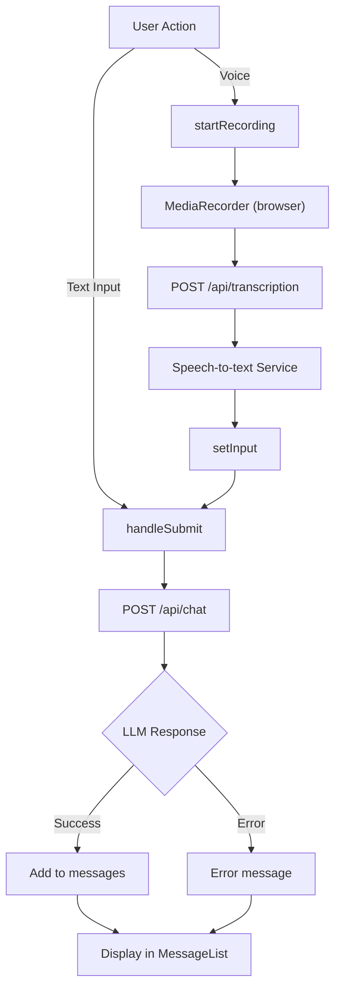

# Chat Interface Feature Guide

**Use this document when you want to understand how the chat system works end-to-end, including user input, message handling, speech-to-text transcription, and LLM responses.**

## Prerequisites

- Familiarity with React hooks (`useState`, `useRef`, `useEffect`)
- Understanding of JavaScript async/await and fetch API
- Knowledge of Next.js API routes

## Overview

The chat interface provides a conversational experience where users send text or voice messages and receive responses from an LLM backend. The system supports three input methods (text input, voice recording with transcription, or mixed), message history display, and loading states.



## How It Works

### Core Components

- **ChatContent.tsx** (`components/ChatContent.tsx`): Main state management component. Handles form submission, recording lifecycle, and API calls.
- **ChatLayout.tsx** (`components/chat/ChatLayout.tsx`): Container component for chat UI (layout structure).
- **MessageList.tsx** (`components/chat/MessageList.tsx`): Displays all messages and loading indicator.
- **ChatInputArea.tsx** (`components/chat/ChatInputArea.tsx`): Text input field and control buttons (send, microphone).

### Process Flow

#### 1. Text Message Submission

```typescript
// User enters text and presses Enter or clicks Send
const handleSubmit = async (e: React.FormEvent) => {
  e.preventDefault();
  if (!input.trim() || isLoading) return;
  
  // Add user message to chat
  const userMessage: Message = { role: "user", content: input };
  setMessages((prev) => [...prev, userMessage]);
  setInput("");
  setIsLoading(true);
  
  try {
    // Call backend chat API
    const response = await fetch("/api/chat", {
      method: "POST",
      headers: { "Content-Type": "application/json" },
      body: JSON.stringify({
        msg: input,
        language: "de"
      }),
    });
    
    const data = await response.json();
    
    // Add assistant response to chat
    const assistantMessage: Message = {
      role: "assistant",
      content: data.response || "Entschuldigung, es gab einen Fehler.",
    };
    setMessages((prev) => [...prev, assistantMessage]);
  } catch (error) {
    // Handle error
  } finally {
    setIsLoading(false);
  }
};
```

**Key states managed:**
- `messages: Message[]` — All chat messages with role ("user" or "assistant") and content
- `input: string` — Current text in input field
- `isLoading: boolean` — True while waiting for LLM response

**Keyboard support:**
- Enter key submits the form
- Shift+Enter adds a newline (textarea behavior)

#### 2. Voice Recording and Transcription

```typescript
// User clicks microphone button to start recording
const startRecording = async () => {
  // Request microphone access
  const stream = await navigator.mediaDevices.getUserMedia({ audio: true });
  const mediaRecorder = new MediaRecorder(stream);
  mediaRecorderRef.current = mediaRecorder;
  audioChunksRef.current = [];
  
  // Collect audio chunks
  mediaRecorder.ondataavailable = (event) => {
    if (event.data.size > 0) {
      audioChunksRef.current.push(event.data);
    }
  };
  
  // When recording stops, send to transcription
  mediaRecorder.onstop = async () => {
    const audioBlob = new Blob(audioChunksRef.current, { type: "audio/webm" });
    await transcribeAudio(audioBlob);
    stream.getTracks().forEach((track) => track.stop());
  };
  
  mediaRecorder.start();
  setIsRecording(true);
};

// Stop recording (user clicks mic button again)
const stopRecording = () => {
  if (mediaRecorderRef.current && isRecording) {
    mediaRecorderRef.current.stop();
    setIsRecording(false);
  }
};

// Send audio to transcription service
const transcribeAudio = async (audioBlob: Blob) => {
  setIsTranscribing(true);
  try {
    const formData = new FormData();
    formData.append("file", audioBlob, "recording.webm");
    
    const response = await fetch("/api/transcription", {
      method: "POST",
      body: formData,
    });
    
    const data = await response.json();
    // Populate text input with transcribed text
    setInput(data.text || "");
  } catch (error) {
    alert("Transkription fehlgeschlagen");
  } finally {
    setIsTranscribing(false);
  }
};
```

**Key states managed:**
- `isRecording: boolean` — True while microphone is active
- `isTranscribing: boolean` — True while waiting for transcription response
- `mediaRecorderRef: MediaRecorder` — Browser's MediaRecorder API instance
- `audioChunksRef: Blob[]` — Accumulated audio chunks during recording

**Audio format:** WebM (browser default)

**User flow:**
1. Click microphone → starts recording, sets `isRecording=true`
2. Click microphone again → stops recording, calls `transcribeAudio()`
3. Speech-to-text service processes audio
4. Transcribed text populates input field
5. User can edit or submit immediately

#### 3. Auto-Scroll to Latest Message

```typescript
// Scroll chat to bottom when new messages arrive
useEffect(() => {
  scrollToBottom();
}, [messages]);

const scrollToBottom = () => {
  messagesEndRef.current?.scrollIntoView({ behavior: "smooth" });
};
```

A hidden `<div ref={messagesEndRef} />` at the bottom of the message list ensures new messages are always visible.

### Key Files and Functions

| File | Function/Component | Purpose |
|------|-------------------|---------|
| `components/ChatContent.tsx` | `ChatContent()` | Main chat state, form handling, API calls |
| `components/ChatContent.tsx` | `handleSubmit()` | Sends text message to LLM |
| `components/ChatContent.tsx` | `startRecording()` / `stopRecording()` | Control browser microphone |
| `components/ChatContent.tsx` | `transcribeAudio()` | Sends audio blob to transcription service |
| `components/chat/MessageList.tsx` | `MessageList()` | Renders message history and loading indicator |
| `components/chat/ChatInputArea.tsx` | `ChatInputArea()` | Text input field, Send button, Microphone button |
| `app/api/chat/route.ts` | `POST /api/chat` | Routes to OpenAI, custom LLM, or mock |
| `app/api/transcription/route.ts` | `POST /api/transcription` | Proxies audio to STT service or returns mock |

## Configuration

### Environment Variables

- `LLM_URL` — Custom LLM backend endpoint (e.g., `http://localhost:8000/chat`)
- `LLM_HEADER` — JSON-stringified headers for custom LLM (e.g., `'{"Authorization": "Bearer token"}'`)
- `OPENAI_API_KEY` — OpenAI API key (if set, takes priority over `LLM_URL`)
- `STT_FORWARD_URL` — Speech-to-text service endpoint (v3 preferred)
- `STT_FORWARD_TOKEN` — Token for STT service (sent as `x-token` header)
- `TRANSCRIPTION_URL` — Alternative STT endpoint (v2 legacy)
- `TRANSCRIPTION_HEADER` — JSON-stringified headers for legacy STT

### Custom LLM Backend Contract

If using a custom LLM backend (not OpenAI), the service must accept and return this JSON format:

**Request to backend:**
```json
{
  "msg": "Wie viel kostet die Mitgliedschaft?",
  "language": "de",
  "context": "optional-session-id"
}
```

**Response from backend:**
```json
{
  "msg": "Wie viel kostet die Mitgliedschaft?",
  "response": "Die Mitgliedschaft kostet ...",
  "language": "de",
  "context": "optional-session-id"
}
```

The response's `response` field is displayed to the user.

## Simulation and Mock Modes

### Chat Mock Mode

If no LLM backend is configured, `POST /api/chat` returns an echo response:

```json
{
  "msg": "User message",
  "response": "Echo: User message",
  "language": "de",
  "context": null
}
```

**Special test trigger:** If the message contains `*waittesting*`, the response delays 35 seconds (for testing long waits).

### Transcription Mock Mode

If no STT service is configured, `POST /api/transcription` returns:

```json
{
  "text": "This is a transcription for the audio."
}
```

## Error Handling

### Common Error Scenarios

- **Microphone access denied** → Alert "Mikrofonzugriff verweigert" (microphone access denied)
- **Transcription fails** → Alert "Transkription fehlgeschlagen" (transcription failed)
- **Chat API error** → Assistant message "Fehler bei der Verbindung zum Server." (server connection error)
- **Invalid LLM response** → Falls back to "Entschuldigung, es gab einen Fehler." (sorry, there was an error)

### Troubleshooting

**Symptom:** Voice recording button doesn't work or no audio is captured

**Cause:** Microphone permissions not granted, browser doesn't support MediaRecorder, or audio input device unavailable

**Solution:**
1. Check browser permissions for microphone access
2. Test with Firefox/Chrome (Safari has limited MediaRecorder support)
3. Verify microphone is connected and working in OS settings
4. Check browser console for permission errors

**Symptom:** Chat sends but no response appears

**Cause:** LLM service is down, API key is invalid, or timeout occurred

**Solution:**
1. Check network tab in browser DevTools for failed requests
2. Verify `OPENAI_API_KEY` or `LLM_URL`/`LLM_HEADER` are set correctly
3. Test the LLM endpoint directly with curl: `curl -X POST http://llm-url -d '{"msg":"test"}'`
4. Check server logs for error details

## Limitations and Considerations

- **No message persistence** — Messages are stored only in client memory; page refresh loses chat history
- **No retry logic** — If LLM request fails, user must send message again
- **Audio format fixed to WebM** — Browser determines codec, not configurable
- **Single LLM priority** — System picks one backend (OpenAI > custom LLM > mock); cannot switch mid-session
- **No concurrent requests** — `isLoading` prevents multiple simultaneous chat requests
- **Language hard-coded to German** — All requests send `language: "de"` (environment variable override possible but not exposed in UI)
- **Microphone always mono** — Recording uses default system settings (no multi-channel support)

## Related Topics

- [Architecture Overview](../getting-started/architecture-overview.md)
- [HeyGen Avatar Integration Guide](./heygen-avatar-integration.md)
- [API Reference: Endpoints](../api-reference/endpoints.md)
- [Environment Setup and Deployment](../deployment-operations/environment-setup.md)
