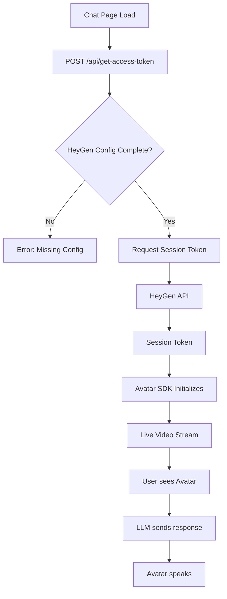

# HeyGen Avatar Integration Feature Guide

**Use this document when you want to understand how the HeyGen Live Avatar video integration works, including configuration, session token generation, and the avatar rendering flow.**

## Prerequisites

- Understanding of HeyGen Live Avatar API
- Knowledge of Next.js API routes
- Familiarity with environment variable configuration
- (Optional) Basic understanding of WebRTC for video streaming

## Overview

The HeyGen Live Avatar integration allows users to interact with an animated AI avatar in real-time video during chat conversations. The avatar is powered by HeyGen's Live Avatar service and configured to speak in German with a specific voice and animation quality level.



## How It Works

### Core Components

- **`app/api/get-access-token/route.ts`** — Next.js server route that requests a session token from HeyGen API
- **Avatar SDK (client-side)** — HeyGen JavaScript SDK embedded in the page that consumes the token and renders the video stream
- **HeyGen Live Avatar API** — External service that manages avatar sessions and video delivery

### Configuration Flow

```typescript
// app/api/get-access-token/route.ts — Full implementation
export async function POST(request: NextRequest) {
  // 1. Read HeyGen configuration from environment
  const heygenApiKey = process.env.HEYGEN_API_KEY;
  const heygenVoiceId = process.env.HEYGEN_VOICE_ID;
  const heygenAvatarId = process.env.HEYGEN_AVATAR_ID || process.env.HEYGEN_AVATAR_NAME;
  const heygenQuality = process.env.HEYGEN_QUALITY || 'high';
  const avatarLanguage = process.env.AVATAR_LANGUAGE || 'de';
  const avatarContextId = process.env.AVATAR_CONTEXT_ID;
  
  // 2. Validate all required fields are present
  if (!heygenApiKey || !heygenVoiceId || !heygenAvatarId) {
    return NextResponse.json(
      { error: 'HeyGen configuration is missing' },
      { status: 400 }
    );
  }
  
  // 3. Validate quality setting
  const validQualities = ['low', 'medium', 'high', 'very_high'];
  if (!validQualities.includes(heygenQuality)) {
    return NextResponse.json(
      { error: 'Invalid HEYGEN_QUALITY value' },
      { status: 400 }
    );
  }
  
  // 4. Build HeyGen session request
  const requestBody: any = {
    mode: 'FULL',
    avatar_id: heygenAvatarId,
    avatar_persona: {
      voice_id: heygenVoiceId,
      language: avatarLanguage,
    },
    video_settings: {
      quality: heygenQuality,
    },
  };
  
  // 5. Add context ID if provided (optional)
  if (avatarContextId) {
    requestBody.avatar_persona.context_id = avatarContextId;
  }
  
  // 6. Request session token from HeyGen API
  const response = await fetch('https://api.liveavatar.com/v1/sessions/token', {
    method: 'POST',
    headers: {
      'X-API-KEY': heygenApiKey,
      'Content-Type': 'application/json',
    },
    body: JSON.stringify(requestBody),
  });
  
  // 7. Extract and return session token
  if (!response.ok) {
    throw new Error(`HeyGen API error: ${response.statusText}`);
  }
  
  const data = await response.json();
  const token = data?.data?.session_token;
  
  if (!token) {
    throw new Error('No session token in HeyGen response');
  }
  
  return NextResponse.json({ token });
}
```

### Session Token Request Format

**Request to HeyGen API (`https://api.liveavatar.com/v1/sessions/token`):**
```json
{
  "mode": "FULL",
  "avatar_id": "alice-b52be46e",
  "avatar_persona": {
    "voice_id": "de_male_voice_001",
    "language": "de",
    "context_id": "optional-context-id"
  },
  "video_settings": {
    "quality": "high"
  }
}
```

**Response from HeyGen (on success):**
```json
{
  "data": {
    "session_token": "eyJhbGciOiJIUzI1NiIsInR5cCI6IkpXVCJ9..."
  }
}
```

### Quality Levels

The `HEYGEN_QUALITY` setting controls video rendering quality and affects bandwidth/performance:

| Quality | Use Case | Bandwidth | CPU |
|---------|----------|-----------|-----|
| `low` | Low-bandwidth environments, testing | Minimal | Minimal |
| `medium` | Good balance (recommended for most) | Moderate | Moderate |
| `high` | Default; good quality, standard bandwidth | Standard | Standard |
| `very_high` | Premium experience, requires good connection | High | High |

### Avatar Configuration Parameters

| Parameter | Environment Variable | Required | Purpose | Example |
|-----------|---------------------|----------|---------|---------|
| Avatar ID | `HEYGEN_AVATAR_ID` or `HEYGEN_AVATAR_NAME` | Yes | Which avatar character to use | `alice-b52be46e` |
| Voice ID | `HEYGEN_VOICE_ID` | Yes | Voice persona (language-specific) | `de_male_voice_001` |
| API Key | `HEYGEN_API_KEY` | Yes | HeyGen API authentication | `sk_xxxxx...` |
| Language | `AVATAR_LANGUAGE` | No | Avatar speech language (default: `de`) | `de`, `en`, `fr` |
| Quality | `HEYGEN_QUALITY` | No | Video quality (default: `high`) | `low`, `medium`, `high`, `very_high` |
| Context ID | `AVATAR_CONTEXT_ID` | No | Optional conversation context | Custom string |

### Avatar Lifecycle

1. **Initialization** — User loads `/chat` page
2. **Token Request** — Frontend calls `POST /api/get-access-token` to get session token
3. **SDK Init** — HeyGen JavaScript SDK initializes with token
4. **Video Stream** — HeyGen establishes WebRTC connection and starts video stream
5. **Ready for Speech** — Avatar appears on screen and can speak
6. **Chat Integration** — When LLM sends response, frontend sends text to avatar service
7. **Avatar Speaks** — Avatar uses configured voice to speak the response (audio + animation)

## Error Handling

### Common Error Scenarios

- **Missing configuration** → HTTP 400 with message "HeyGen configuration is missing"
  - **Cause:** One or more of `HEYGEN_API_KEY`, `HEYGEN_VOICE_ID`, `HEYGEN_AVATAR_ID` not set
  - **Solution:** Set all three environment variables

- **Invalid quality setting** → HTTP 400 with message "Invalid HEYGEN_QUALITY value"
  - **Cause:** `HEYGEN_QUALITY` is set to value not in `['low', 'medium', 'high', 'very_high']`
  - **Solution:** Use one of the four valid values

- **HeyGen API error** → HTTP 500 with message "HeyGen API error: [statusText]"
  - **Cause:** HeyGen API returned error (invalid key, quota exceeded, service down)
  - **Solution:** Verify `HEYGEN_API_KEY` is valid and check HeyGen service status

- **No session token in response** → HTTP 500 with message "No session token in HeyGen response"
  - **Cause:** HeyGen API responded successfully but response structure is unexpected
  - **Solution:** Contact HeyGen support; check API version compatibility

### Troubleshooting

**Symptom:** Avatar doesn't appear on chat page

**Cause:** Session token request failed or frontend didn't call the endpoint

**Solution:**
1. Check browser console for JavaScript errors
2. Open DevTools Network tab and verify `POST /api/get-access-token` succeeds
3. Check server logs for errors in `/api/get-access-token`
4. Verify all HeyGen environment variables are set: `echo $HEYGEN_API_KEY`, etc.

**Symptom:** "HeyGen configuration is missing" error

**Cause:** One or more required environment variables are not set

**Solution:**
```bash
# Verify all three are set
echo "HEYGEN_API_KEY: $HEYGEN_API_KEY"
echo "HEYGEN_AVATAR_ID: $HEYGEN_AVATAR_ID"
echo "HEYGEN_VOICE_ID: $HEYGEN_VOICE_ID"

# If missing, add to .env.local
HEYGEN_API_KEY=sk_xxxxxxxx
HEYGEN_AVATAR_ID=alice-b52be46e
HEYGEN_VOICE_ID=de_male_voice_001
```

**Symptom:** Avatar video stream is laggy or stutters

**Cause:** Network bandwidth insufficient or video quality too high for connection

**Solution:**
1. Reduce `HEYGEN_QUALITY` from `high` to `medium` or `low`
2. Check network connection speed (`speedtest.net`)
3. Close other bandwidth-consuming applications
4. Try a different browser or device

**Symptom:** Avatar doesn't speak when sending chat messages

**Cause:** Frontend not configured to send text to avatar SDK, or SDK initialization incomplete

**Solution:**
1. Verify chat page loads avatar (video element visible)
2. Check if HeyGen SDK supports text-to-speech in your configuration
3. See HeyGen Live Avatar documentation for speech integration

## Configuration

### Required Environment Variables

```bash
# HeyGen Live Avatar Configuration
HEYGEN_API_KEY=sk_xxxxx              # Your HeyGen API key
HEYGEN_AVATAR_ID=alice-b52be46e      # Avatar character ID
HEYGEN_VOICE_ID=de_male_voice_001    # Voice persona ID
```

### Optional Environment Variables

```bash
# Avatar Customization
HEYGEN_QUALITY=high                  # Video quality: low, medium, high, very_high (default: high)
AVATAR_LANGUAGE=de                   # Speech language (default: de)
AVATAR_CONTEXT_ID=                   # Optional conversation context
```

### Finding Your Avatar and Voice IDs

Avatar and voice IDs are specific to your HeyGen account and the avatars you've created or purchased. To find them:

1. Log in to HeyGen Studio at `https://app.heygen.com`
2. Navigate to "Avatars" section
3. Select your avatar → copy Avatar ID
4. Navigate to "Voices" section
5. Select your voice → copy Voice ID (format: `language_gender_voice_code`, e.g., `de_male_voice_001`)

<!-- TODO_ConfluenceLink(EMMA/Configuration/HeyGen-Setup, "Link to centralized HeyGen setup documentation") -->

## Integration with Chat System

The avatar displays alongside the chat interface but operates independently for token generation. The chat system (`ChatContent.tsx`) does not directly integrate with the avatar SDK in the current implementation.

**Current flow:**
1. User types/speaks message → `/api/chat` returns LLM response
2. Message displayed in chat UI
3. Avatar video streams independently (no automatic speech integration)

**Future integration opportunities:**
- Send LLM response text to avatar for speech synthesis
- Use avatar audio/video stream as chat context
- Support voice commands recognized by avatar service

## Limitations and Considerations

- **Token expires** — HeyGen session tokens have a time limit; long sessions may need token refresh
- **Bandwidth required** — Live video streaming requires stable internet connection (recommend 1+ Mbps)
- **Browser support** — Requires WebRTC support (Chrome, Firefox, Edge; limited Safari support)
- **One avatar per session** — Current implementation supports one avatar instance; multiple avatars not configured
- **Language-specific voices** — Voice IDs are tied to languages; German voices only support `language: "de"`
- **No fallback UI** — If avatar fails to load, chat continues but avatar video area remains empty
- **API key in environment** — HeyGen API key stored server-side; never exposed to client

## Related Topics

- [Chat Interface Feature Guide](./chat-interface.md)
- [Architecture Overview](../getting-started/architecture-overview.md)
- [Environment Setup and Deployment](../deployment-operations/environment-setup.md)
- [API Reference: Endpoints](../api-reference/endpoints.md)
